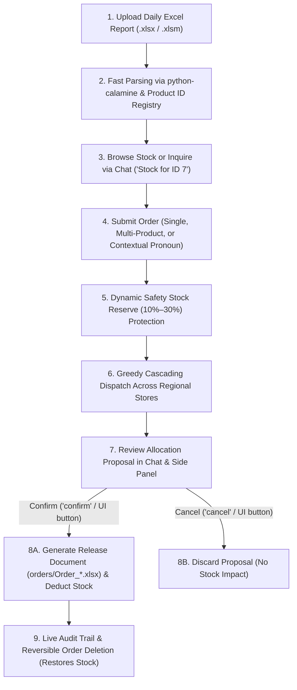

# 📦 Enterprise Multi-Store Inventory & Order Allocation System

An intelligent multi-store inventory allocation chatbot and management dashboard with **multi-turn conversation context memory**, **dynamic safety buffer reservation**, and an **integrated Knowledge Base**. 

The system operates directly from daily uploaded Excel stock reports (`.xlsx` / `.xlsm`), automatically parses client orders (by **Product ID**, product name, or multi-item lists), computes optimal regional dispatch across distribution hubs with safety stock protection, generates standalone Excel release orders, and provides a real-time audit trail with automated stock restoration upon cancellation.

---

## 🏛️ System Architecture & Workflow

```text
User Input (Interactive Chat / Natural Language / Direct Order Form)
        │
        ├── 1. NLP & Context Engine:
        │      • Maps numeric Product IDs ("ID 7") or product names
        │      • Parses multi-item orders ("50 of ID 7, 20 of ID 12")
        │      • Resolves pronouns & relative references ("this", "that", "same item")
        │      • Extracts client/party names ("Party Bilal", "Client Alpha")
        │
        ├── 2. Knowledge Base Retrieval:
        │      • Answers queries on safety buffers, regional hubs, SLAs & payment terms
        │
        ▼
Allocation & Cascading Engine (inventory_manager.py)
        │
        ├── 3. Reads regional store inventory from daily report in 'data/' via python-calamine
        ├── 4. Calculates dynamic safety stock reserve (10%–30%, default 15%) per store
        ├── 5. Greedy Cascading: Fulfills order starting from stores with highest available stock
        │
        ▼
Order Confirmation & Release (via Chat "confirm" or UI Button)
        │
        ├── A. Generates Standalone Release Document: 'orders/Order_{ID}_{Party}.xlsx'
        ├── B. Dynamic Stock Deduction: Subtracts dispatched quantities from current report totals
        ├── C. Context Memory Update: Records Order ID & dispatch breakdown for follow-up queries
        └── D. Audit Trail & Reversibility: Order history aggregated dynamically; cancelling an order
               deletes its Excel file and automatically restores units back to store stock
```

---

## 📁 Project Directory Structure

```text
stock-chatbot/
│
├── data/                           # Storage folder for the daily uploaded stock report
│   └── [daily_report].xlsx         # Latest uploaded Excel report (source of truth for stock)
│
├── orders/                         # Output directory for released order documents
│   └── Order_ORD-..._Party.xlsx    # Standalone Excel release documents (sheet: Release_Details)
│
├── app.py                          # Streamlit web application & multi-tab UI
├── inventory_manager.py            # Core business logic: report parser, allocation engine, NLP & order lifecycle
├── knowledge_base.py               # Domain knowledge base (policies, regional hubs, FAQs, lead times)
├── product_ids.json                # Persistent registry mapping products to stable numeric IDs (1, 2, 3...)
├── requirements.txt                # Python dependencies (streamlit, pandas, openpyxl, python-calamine)
├── run_app.bat                     # Windows one-click launcher script
├── setup_data.py                   # Optional legacy utility for generating mock store data
└── README.md                       # System documentation
```

---

## ✨ Key System Features

### 1. 🏬 Daily Excel Report Ingestion (`python-calamine`)
- High-speed reading of multi-sheet Excel reports (`.xlsx`, `.xlsm`) using `python-calamine`.
- Automatically parses product categories, regional store offices, batch numbers, expiry dates, sales, and closing balances.
- **Non-destructive**: The uploaded report remains unaltered. All deductions are calculated dynamically from released order documents tied to the current report date.
- Displays report metadata: date of report, report age warnings, offices detected, and units deducted.

### 2. 🔢 Persistent Product ID Registry (`product_ids.json`)
- Assigns short, convenient numeric IDs (`1`, `2`, `3`, ...) to every catalog item.
- Persisted in `product_ids.json` across sessions and daily report uploads so product IDs remain consistent.
- Fast ordering via chat: simply type `Party Bilal wants 50 of ID 7`.

### 3. 🛡️ Dynamic Safety Stock Buffer
- Configurable safety buffer slider (10% to 30%, default 15%) in the sidebar.
- **Formula:**
  $$\text{Safety Buffer} = \lceil \text{Store Stock} \times \text{Buffer \%} \rceil$$
  $$\text{Salable Stock} = \max(0, \text{Store Stock} - \text{Safety Buffer})$$
- Ensures regional walk-in clients and local emergencies never face stockouts from bulk orders.

### 4. 🔄 Auto-Cascading Multi-Store Fulfillment
- If a single regional store cannot fulfill the full requested quantity, the allocation engine prioritizes stores with the highest available salable stock.
- Automatically splits the dispatch across multiple stores to achieve 100% fulfillment whenever possible.
- Detailed breakdown shows exactly how many units are dispatched from each store and remaining buffer levels.

### 5. 🧠 Conversational Context Memory & Multi-Product Orders
- **Multi-product orders**: Handles multiple items in a single sentence:
  > *"Party Bilal wants 50 of ID 7, 20 of ID 12 and 100 of ID 30"*  
  All items are evaluated, allocated, and released together under a single unified Order ID.
- **Pronoun & context resolution**:
  > User: *"Check stock for Avitryl Oral Solution"* (or *"ID 1"*)  
  > Assistant: *[Displays stock breakdown across all offices]*  
  > User: *"Party Bilal wants 150 of this"*  
  > Assistant: *[Automatically resolves "this" to Avitryl Oral Solution]*
- **In-Chat confirmation & cancellation**: Type `"confirm"`, `"proceed"`, or `"cancel"` directly in the chat.
- **Contextual queries**: Ask *"What was the order ID?"* or *"Which stores dispatched?"*.

### 6. 📄 Standalone Release Orders & Reversible Cancellations
- Each confirmed order creates an Excel document (`orders/Order_{ID}_{Party}.xlsx`) with full dispatch details, item codes, quantities, and fulfilling store sheets.
- Released orders can be downloaded directly from the web interface.
- **Order Cancellation**: If a client cancels an order, deleting it from Tab 3 removes the file and automatically restores dispatched stock back to the active report.

---

## 🔄 Step-by-Step System Walkthrough (How It Works)

The following 8-step lifecycle demonstrates how the system processes inventory and orders from raw upload to final release:



### **Step 1: Daily Report Upload & Ingestion**
1. The user navigates to **Tab 2: 🏬 Stock (Daily Report)** and uploads today's stock report (`.xlsx` or `.xlsm`), or saves it directly in the `data/` directory.
2. The engine uses `python-calamine` to parse visible sheets with `"Products"` and `"Closing Balance"` headers.
3. The original uploaded file is treated as an immutable source of truth and is never altered.

### **Step 2: Persistent Product ID Mapping**
1. The catalog parser extracts every unique SKU and checks it against `product_ids.json`.
2. Existing products retain their permanent numeric ID (e.g. `ID 7` &rarr; `AQUAMIN-1LTR`).
3. Any newly discovered products are automatically assigned the next available integer ID and saved to `product_ids.json`.
4. Users can now reference products in chat by either their short ID (`ID 7`) or product name.

### **Step 3: Checking Stock & Context Caching**
1. A user can inspect stock across all regional distribution hubs in Tab 2, or ask in chat:
   > *"Check stock for Avitryl Oral Solution"* (or *"ID 1 stock"*)
2. The assistant responds with the stock breakdown across all regional offices (Karachi, Lahore, Faisalabad, etc.) and the total network balance.
3. The assistant automatically caches this item in the session's **Conversational Memory Context**.

### **Step 4: Order Intake & NLP Parsing**
1. The user inputs an order via the chat interface or the manual form in Tab 1:
   - **Single Item:** `"Party Bilal wants 50 of ID 7"`
   - **Multi-Product:** `"Party Bilal wants 50 of ID 7, 20 of ID 12 and 100 of ID 30"`
   - **Contextual Reference:** After checking stock, user says: `"Party Bilal wants 150 of this"`
2. The NLP parser extracts:
   - **Client/Party Name:** Identifies `"Party Bilal"` or falls back to the previous party in context.
   - **Products & Quantities:** Resolves numeric IDs, product names, and associated quantities.
   - **Pronoun Resolution:** Seamlessly binds relative terms (`"this"`, `"that"`, `"it"`, `"same item"`) to the cached item.

### **Step 5: Safety Buffer Calculation**
1. The engine checks the active safety buffer setting (slider in sidebar, default 15%, adjustable from 10% to 30%).
2. For each store holding the item, it calculates:
   $$\text{Safety Buffer} = \lceil \text{Store Stock} \times \text{Buffer \%} \rceil$$
   $$\text{Salable Stock} = \max(0, \text{Store Stock} - \text{Safety Buffer})$$
3. This reserved buffer cannot be consumed by client orders, protecting stock for retail walk-ins and local emergencies.

### **Step 6: Greedy Multi-Store Cascading Allocation**
1. Stores with salable stock are sorted in descending order (highest available stock first).
2. The engine attempts to fulfill the requested units from the primary store.
3. If the primary store does not have enough salable units, it takes all available units from that store and cascades the remaining quantity to secondary stores.
4. Fulfills 100% of the request whenever network stock permits (`FULL`), or allocates maximum available units if there is a network shortage (`PARTIAL`).

### **Step 7: Proposal Review & Interactive Breakdown**
1. The assistant posts a clear allocation proposal in the chat:
   - Shows fulfillable vs. requested quantities.
   - Notes safety stock held.
   - Summarizes multi-store splits (e.g. *Karachi: 100 units, Lahore: 50 units*).
2. The **Order Dispatch Panel** on the right displays an interactive breakdown table detailing each store's dispatch count, remaining stock, safety buffer kept, and store status.

### **Step 8: Order Confirmation, Release & Reversibility**
1. **Confirmation:**
   - The user replies `"confirm"` in chat or clicks **"✅ Confirm & Release"**.
   - Generates an official Excel document in `orders/Order_{Order_ID}_{Party}.xlsx` containing full dispatch rows on the `Release_Details` sheet.
   - Deducts dispatched stock in real time for all subsequent queries.
   - Stores the Order ID in context memory for follow-up questions (`"What was the order ID?"`).
2. **Cancellation / Rejection:**
   - The user can type `"cancel"` or click **"❌ Cancel Order"** to safely discard any active proposal.
3. **Reversible Audit Trail (Tab 3):**
   - Review consolidated order history and download release Excel files.
   - If an order is cancelled by a client after release, deleting it from Tab 3 removes the document and **automatically restores the dispatched units** back to the active report's store stock!

---

## 🖥️ Web Interface Overview

The Streamlit interface is organized into 4 dedicated tabs:

| Tab | Purpose | Features |
|---|---|---|
| **💬 1. Chatbot & Order Dispatch** | Primary conversational order management | Real-time chat, context inspector, allocation preview table, one-click "Confirm & Release" / "Cancel", and manual direct-order entry form. |
| **🏬 2. Stock (Daily Report)** | Daily stock report viewer & uploader | Drag-and-drop report uploader, combined cross-office stock matrix, single-office drill-downs, search filter, and raw batch/expiry detail viewer. |
| **📄 3. Released Orders History** | Audit trail & document management | Consolidated released orders ledger, one-click order cancellation with automatic stock restoration, and direct Excel download buttons. |
| **📚 4. Knowledge Base & FAQs** | Operations & policy reference | Interactive keyword search, categorized articles covering safety buffers, cascading rules, regional hub locations, SLAs, and commercial terms. |

---

## 🚀 Getting Started & Execution

### Prerequisites
- **Python 3.10+** installed on your system.

---

### Option 1: Standard Terminal / VS Code (Recommended)

1. **Open the project folder** in your terminal or VS Code:
   ```bash
   cd stock-chatbot
   ```

2. **Activate the virtual environment** (or create one if needed):
   - **PowerShell (Windows):**
     ```powershell
     .\.venv\Scripts\Activate.ps1
     ```
   - **Command Prompt (Windows):**
     ```cmd
     .venv\Scripts\activate.bat
     ```
   - **Linux / macOS:**
     ```bash
     source .venv/bin/activate
     ```

3. **Install dependencies:**
   ```bash
   pip install -r requirements.txt
   ```

4. **Launch the Streamlit application:**
   ```bash
   streamlit run app.py
   ```

5. **Upload your stock report:**
   - When the web browser opens (`http://localhost:8501`), navigate to the **🏬 Stock (Daily Report)** tab.
   - Upload today's stock report (`.xlsx` or `.xlsm`).
   - You are ready to view stock and dispatch orders via the chatbot!

---

### Option 2: Windows One-Click Batch Script

Double-click **`run_app.bat`**. The script will automatically:
1. Detect or use the virtual environment / system Python.
2. Install or verify required dependencies from `requirements.txt`.
3. Check the `data/` directory for existing stock reports.
4. Launch the Streamlit application in your default browser.

---

## 💬 Example Chat Commands

| Intent | Example Prompt |
|---|---|
| **Check Stock by Name** | `"Check stock for Avitryl Oral Solution"` |
| **Check Stock by ID** | `"Stock for ID 7"` or `"#7 stock"` |
| **Single Product Order** | `"Party Bilal wants 50 of ID 7"` |
| **Multi-Product Order** | `"Party Bilal wants 50 of ID 7, 20 of ID 12 and 100 of ID 30"` |
| **Contextual Follow-up** | *"Check stock for Aquamin"* &rarr; `"Order 100 of this for Client Alpha"` |
| **Confirm Proposal** | `"confirm"`, `"proceed"`, or `"release order"` |
| **Cancel Proposal** | `"cancel"` or `"abort"` |
| **Query Last Order** | `"What was the order ID?"` or `"Which stores dispatched?"` |
| **Knowledge Base Inquiry** | `"What is safety stock?"`, `"Where are our regional hubs?"`, `"Delivery lead times?"` |
